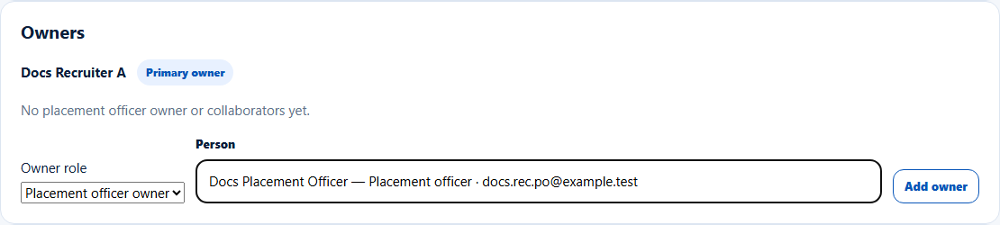
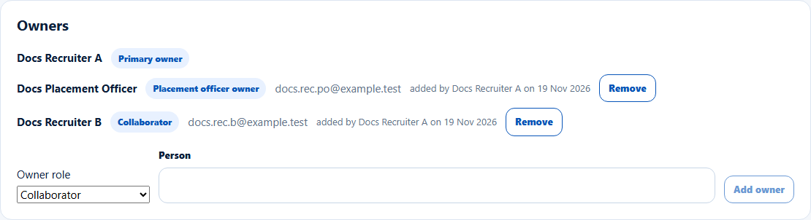
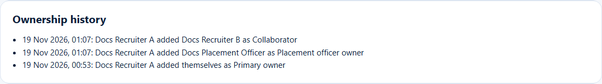
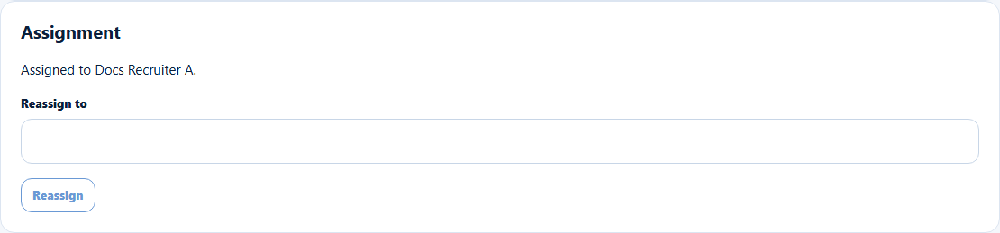

# Owners, collaborators and assignment
> Doc ID: DOC-REC-REQ-009 · Verified on 2026-11-19 against `main` @ `6b61546c` · Roles: Recruiter (primary owner), Team Lead

## Purpose
Share a requirement with the people who work on it: a placement officer, other recruiters as collaborators, and, for the Team Lead, the recruiter it is assigned to.

## Who Can Use This Feature
- The **primary owner** (the recruiter who added it) adds and removes owners.
- The **Team Lead** adds owners and reassigns the requirement.
- An added Placement Officer finds it in their own [list](req-001-requirements-list.md) and gets [a smaller page](../placement-officer/po-001-co-owned-requirements.md).

## Prerequisites
- The person has a recruitment account (Recruiter or Placement Officer).

## How to Access
Requirement page → **Owners** (Team Lead also: **Assignment**).

## Steps
### Step 1 — Add an owner
Choose the **Owner role** (**Placement officer owner** or **Collaborator**), type in **Person** and pick from the list, then select **Add owner**: **Docs Placement Officer added as Placement officer owner.**

Docs Recruiter A then added **Docs Recruiter B** as **Collaborator**. The card lists the **Primary owner** and each added person with their role, email, who added them and when, and a **Remove** button.

### Step 2 — Ownership history
**Ownership history** lists each change, newest first: "Docs Recruiter A added Docs Recruiter B as Collaborator", "… added Docs Placement Officer as Placement officer owner", "… added themselves as Primary owner".

### Step 3 — Reassign (Team Lead)
The Team Lead's **Assignment** card says "Assigned to Docs Recruiter A." Type a recruiter in **Reassign to** and select **Reassign** to move the requirement (not done in this guide; bulk moves are in [Team reassignment](../../admin-manual/admin/adm-004-team-reassign.md)).

## Validation Messages
| Message | When |
|---|---|
| {name} added as {role}. | Owner added |

## Tips
- Until someone is added, the requirement is hidden from them: the Placement Officer opening its link saw **Job requirement not found**.
- The Placement Officer's own list says "The primary owner or a placement manager adds you."

## Related Features
- [Co-owned requirements (Placement Officer)](../placement-officer/po-001-co-owned-requirements.md)
- [Requirement page](req-003-requirement-page.md)
