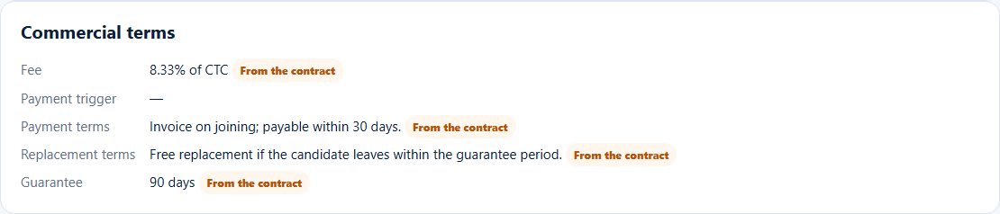
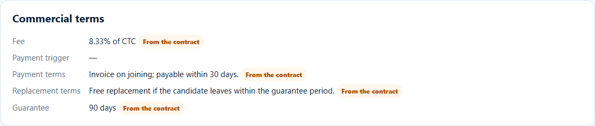

# Commercial terms
> Doc ID: DOC-REC-REQ-010 · Verified on 2026-11-19 against `main` @ `6b61546c` · Roles: Recruiter (owner), Team Lead

## Purpose
See the fee and terms that apply to a requirement, so you know what the placement is worth and when the client pays, without leaving the requirement.

## Who Can Use This Feature
- **Recruiter** owner and **Team Lead** see the card. The Placement Officer's page does not show it.
- This guide only **views** terms. No fee, invoice or payment is entered (owner decision R3).

## Prerequisites
- The company has a contract with terms ([Contract](../companies/co-008-contract.md)).

## How to Access
Requirement page → **Commercial terms**.

## Steps
### Step 1 — Read the terms
The card shows **Fee**, **Payment trigger**, **Payment terms**, **Replacement terms** and **Guarantee**. Each value taken from the company contract is marked **From the contract**. For REQ-000005: Fee **8.33% of CTC**, Payment terms "Invoice on joining; payable within 30 days.", free replacement within the guarantee period, Guarantee **90 days**. Payment trigger was not set (**—**).

The Team Lead sees the same values.

## Tips
- To change the terms for every requirement of a company, change the [contract](../companies/co-008-contract.md).
- The Team Lead also sees **Set fee for this requirement** on the **Revenue** card, for a fee that differs from the contract. Revenue and invoices are Phase 2 and are not used in this guide.

## Related Features
- [Contract](../companies/co-008-contract.md)
- [Validation checklist](req-005-checklist-tasks.md) (the **Commercial terms** item)
