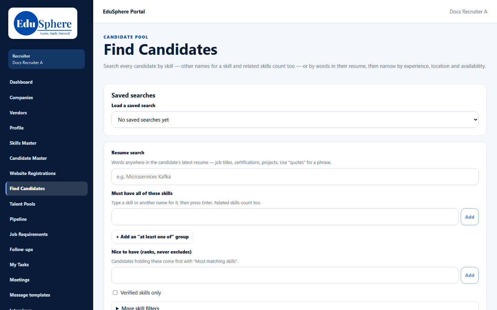
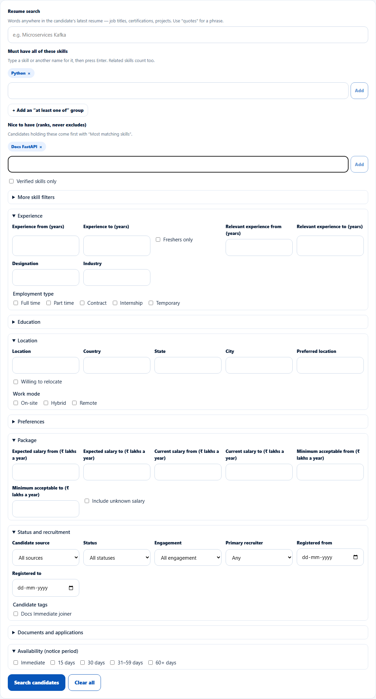
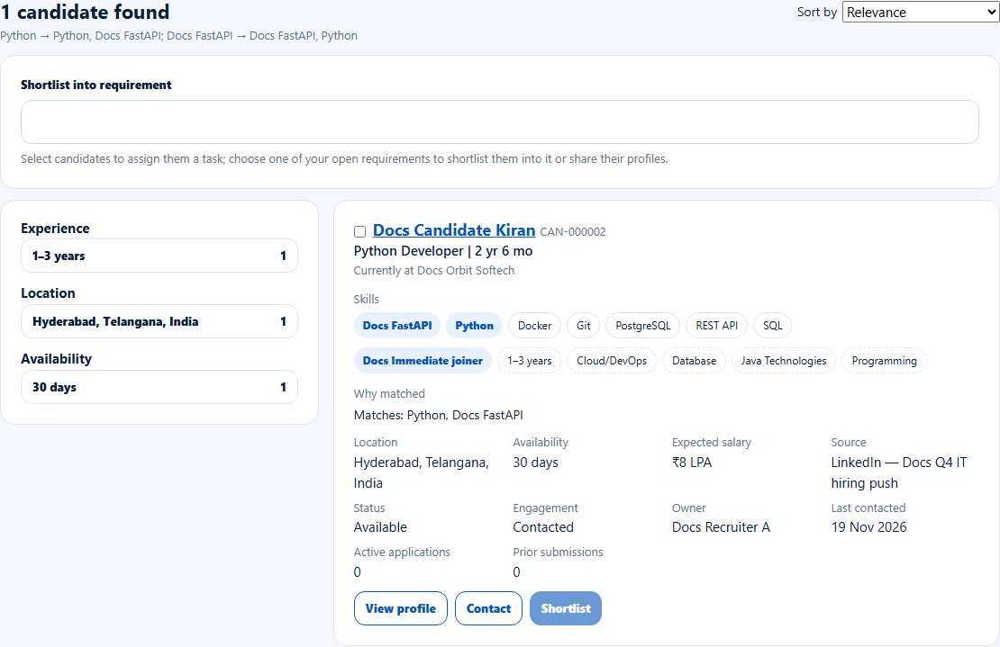

# Find Candidates by skill
> Doc ID: DOC-REC-SRCH-001 · Verified on 2026-11-19 against `main` @ `6b61546c` · Roles: Recruiter, Team Lead, HR (read)

## Purpose
Search the whole candidate pool for people with the skills a job needs, see why each one matched, and rank the best fits first.

## Who Can Use This Feature
| Role | What they get |
|---|---|
| Recruiter, Team Lead | Every filter, including **Package** (salary) and **Candidate source**; **Shortlist**, **Contact** and the bulk actions ([Bulk actions](srch-004-bulk-actions.md)). |
| Team Lead | Also **Export CSV** / **Export Excel** ([Saved searches and export](srch-003-saved-searches-export.md)). |
| HR | Search and **View profile** only; no salary filters, no salary on the cards, no source filter ([HR read-only views](../hr/hr-006-read-only-candidates.md)). |

## Prerequisites
- Candidates with skills on their profiles ([Skills](../candidates/can-005-skills-tags.md)).

## How to Access
Sidebar → **Find Candidates** (`/recruiter/find-candidates`).

## Steps
### Step 1 — Open the search
"Search every candidate by skill — other names for a skill and related skills count too — or by words in their resume, then narrow by experience, location and availability."

### Step 2 — Enter the skills
- **Must have all of these skills**: type a skill (or another name for it) and press Enter. Every skill entered is required. **+ Add an "at least one of" group** adds a set where any one skill is enough.
- **Nice to have (ranks, never excludes)**: "Candidates holding these come first with 'Most matching skills'."
- **Verified skills only**: ignore skills that are only claimed.

Docs Recruiter A entered **Python** (must have) and **Docs FastAPI** (nice to have).

### Step 3 — Search and read the results
Select **Search candidates**. The result says how many were found ("1 candidate found") and how each skill was widened ("Python → Python, Docs FastAPI; Docs FastAPI → Docs FastAPI, Python": related skills count). Each card shows the name and ID, role and experience, current company, skills (those that matched are highlighted "matches your search"), tags, **Why matched**, location, availability, expected salary, source, status, engagement, owner, last contacted, active applications and prior submissions, with **View profile**, **Contact** and **Shortlist**.

## Tips
- With no skill and no resume words the page says "Add a skill or a resume search to search every candidate in the pool."
- **Clear all** empties every filter.
- The [Recruiter dashboard](../dashboard/dash-001-recruiter-dashboard.md) has a **Find Candidates by Skill** shortcut.

## Related Features
- [Resume search and refine filters](srch-002-resume-search-refine.md)
- [Bulk actions](srch-004-bulk-actions.md)
- [Talent pools](srch-005-talent-pools.md)
