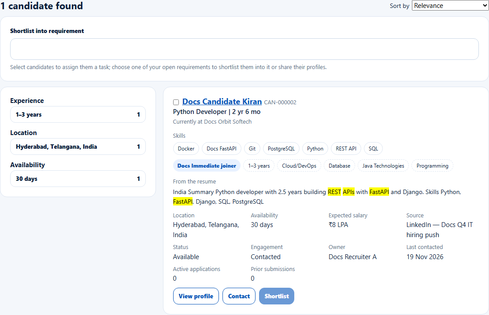
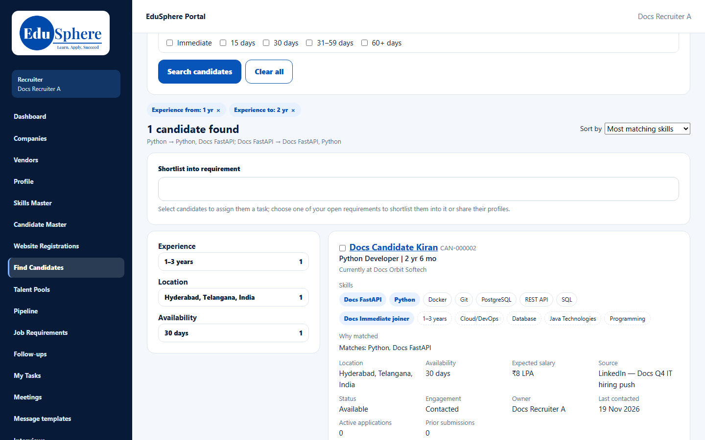

# Resume search and refine filters
> Doc ID: DOC-REC-SRCH-002 · Verified on 2026-11-19 against `main` @ `6b61546c` · Roles: Recruiter, Team Lead, HR (read)

## Purpose
Find candidates by words in their resume, and narrow any search by experience, location, package, status and availability.

## Who Can Use This Feature
- **Recruiter** and **Team Lead**: all filters. **HR**: all except **Package** and **Candidate source**.

## Prerequisites
- For resume search: candidates with an uploaded [resume](../candidates/can-006-resume.md).

## How to Access
**Find Candidates**.

## Steps
### Step 1 — Search the resumes
**Resume search**: "Words anywhere in the candidate's latest resume — job titles, certifications, projects. Use "quotes" for a phrase." Docs Recruiter A searched `"REST APIs" FastAPI`. Each card then shows **From the resume** with the lines that matched.

### Step 2 — Narrow with filters
The filter groups, each opening to its fields:

| Group | Filters |
|---|---|
| More skill filters | Verified skills only |
| Experience | Experience from/to (years), Freshers only, Relevant experience from/to, Designation, Industry, Employment type |
| Education | Qualification |
| Location | Location, Country, State, City, Preferred location, Willing to relocate, Work mode |
| Package (not HR) | Expected, current and minimum acceptable salary from/to (₹ lakhs a year), Include unknown salary |
| Status and recruitment | Candidate source (not HR), Status, Engagement, Primary recruiter (Any, Me, Nobody yet), Registered from/to, Candidate tags |
| Documents and applications | Availability (notice period): Immediate, 15 days, 30 days, 31–59 days, 60+ days |

### Step 3 — Refine from the results
Down the side of the results, **Experience**, **Location** and **Availability** list the values found with a count. Select one to add it as a filter. **Sort by**: Relevance, Most matching skills, Most experience, Lowest expected salary (not HR), Newest registration, Most recent activity, Most complete profile. Active filters show as chips with **×** to remove each.

## Tips
- Selecting the **1–3 years** band set the filters to "Experience from: 1 yr" and "Experience to: 2 yr".
- Every search is in the address bar, so a search can be bookmarked; to share it with colleagues use a [saved search](srch-003-saved-searches-export.md).

## Related Features
- [Find Candidates by skill](srch-001-find-candidates.md)
- [Saved searches and export](srch-003-saved-searches-export.md)
