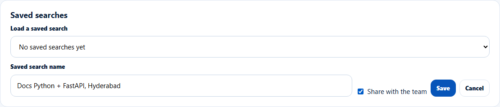
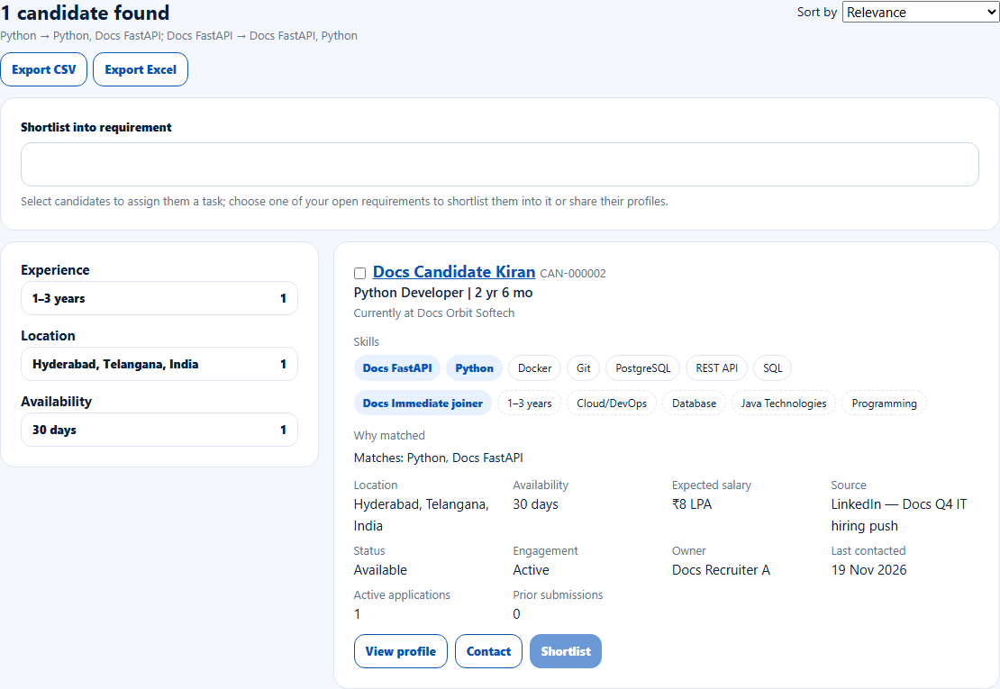

# Saved searches and export
> Doc ID: DOC-REC-SRCH-003 · Verified on 2026-11-19 against `main` @ `6b61546c` · Roles: Recruiter, Team Lead (export)

## Purpose
Keep a search you run often, share it with the team, and (Team Lead) export the results to a spreadsheet.

## Who Can Use This Feature
- **Recruiter** and **Team Lead** save and load searches.
- Only the **Team Lead** sees **Export CSV** and **Export Excel** (the export permission is not given to recruiters or HR).

## Prerequisites
- A search with at least one skill or resume word.

## How to Access
**Find Candidates** → **Saved searches** (top of the page).

## Steps
### Step 1 — Save the search
Run the search, then select **Save this search**. Enter the **Saved search name**, tick **Share with the team** if colleagues should see it, and select **Save**: **Saved "Docs Python + FastAPI, Hyderabad".**

### Step 2 — Load it later
**Load a saved search** lists **My searches** and **Shared with the team** (with the owner's name, for example "Docs Python + FastAPI, Hyderabad — Docs Recruiter A"). Choosing one runs it at once. Your own searches also offer **Update with current filters** and **Delete** ("Delete '{name}' for the whole team?" when shared).

### Step 3 — Export (Team Lead)
With results on screen, select **Export CSV** or **Export Excel**. The file `candidates.csv` (or `.xlsx`) has: Candidate ID, Name, Preferred role, Current company, Experience (years), Location, Notice (days), Skills, Source, Status, Engagement, Expected salary (₹ a year).

## Validation Messages
| Message | When |
|---|---|
| Saved "{name}". | Search saved |
| Some filters in this saved search are no longer available and were ignored: … | An old saved search uses a removed filter (from code; not captured) |

## Tips
- The export contains contact-free columns only (no mobile or email).

## Related Features
- [Find Candidates by skill](srch-001-find-candidates.md)
- [Resume search and refine](srch-002-resume-search-refine.md)
