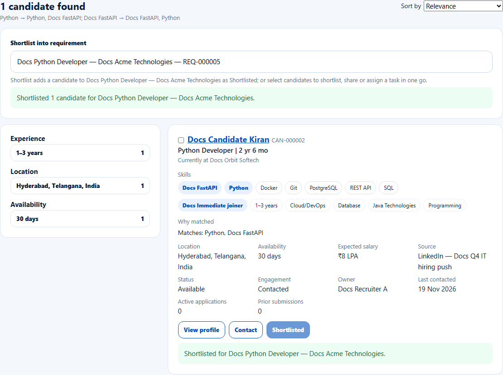
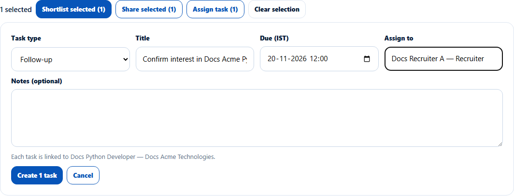

# Bulk actions: shortlist, share, assign a task
> Doc ID: DOC-REC-SRCH-004 · Verified on 2026-11-19 against `main` @ `6b61546c` · Roles: Recruiter, Team Lead

## Purpose
Act on the candidates a search finds: shortlist them onto a job requirement, share their profiles, or give someone a follow-up task, one at a time or several at once.

## Who Can Use This Feature
- **Recruiter** and **Team Lead**. HR sees no selection boxes or actions.

## Prerequisites
- An open job requirement you can work on (for shortlist and share).

## How to Access
**Find Candidates** → run a search.

## Steps
### Step 1 — Choose the requirement
In **Shortlist into requirement**, type and pick one of your open requirements (here **Docs Python Developer — Docs Acme Technologies — REQ-000005**). "Shortlist adds a candidate to {requirement} as Shortlisted; or select candidates to shortlist, share or assign a task in one go." **Shortlist** and **Share selected** stay disabled until a requirement is chosen.

### Step 2 — Select candidates
Tick the box beside each candidate's name. A bar shows **{n} selected** with **Shortlist selected ({n})**, **Share selected ({n})**, **Assign task ({n})** and **Clear selection**.

### Step 3 — Shortlist
Select **Shortlist selected** (or **Shortlist** on one card): **Shortlisted 1 candidate for Docs Python Developer — Docs Acme Technologies.** The card's button turns to **Shortlisted**. Kiran is now on REQ-000005's candidate list (see the hiring flow).

### Step 4 — Assign a task
Select **Assign task**, fill in **Task type** (Follow-up, Resume screening, Interview coordination, Employer feedback), **Title**, **Due (IST)**, **Assign to** (pick a recruiter from the list) and **Notes (optional)**, then **Create {n} task**: **Created 1 task.** Each selected candidate gets the task.

### Step 5 — Share
**Share selected** sends the selected profiles to the client for the chosen requirement. Profile sharing is explained with the hiring flow (later session).

## Validation Messages
| Message | When |
|---|---|
| Shortlisted {n} candidate(s) for {requirement}. | Shortlisted |
| Created {n} task. | Tasks created |
| Choose a recruiter from the list. | **Assign to** typed but not picked |

## Tips
- After shortlisting, the card's button reads **Shortlisted** for that requirement.

## Related Features
- [Find Candidates](srch-001-find-candidates.md)
- [Candidate tasks](../candidates/can-008-notes-tasks-timeline.md)
