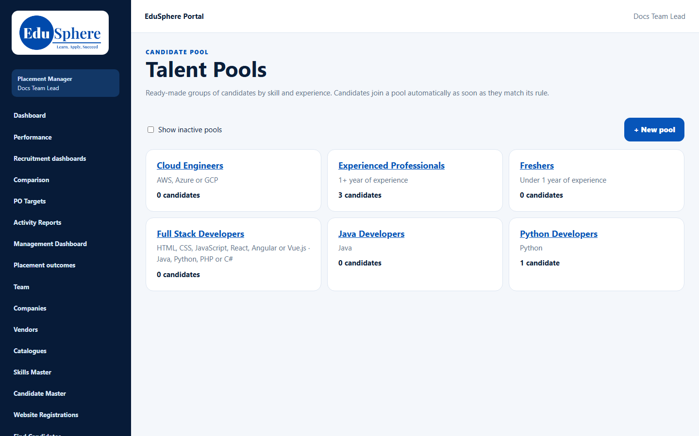
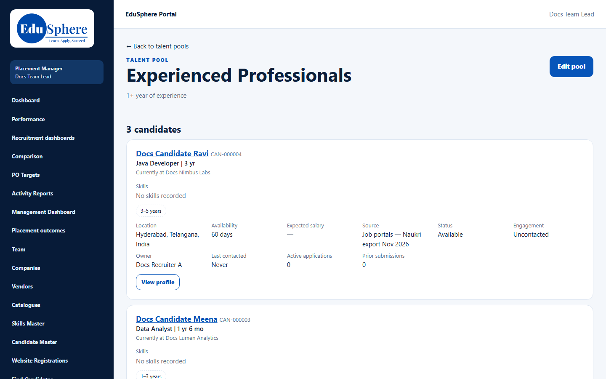
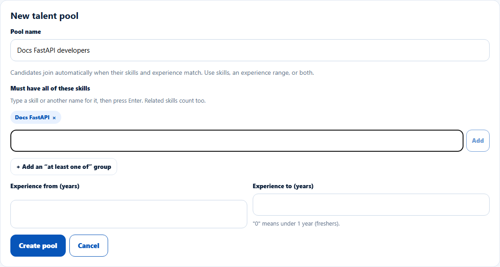
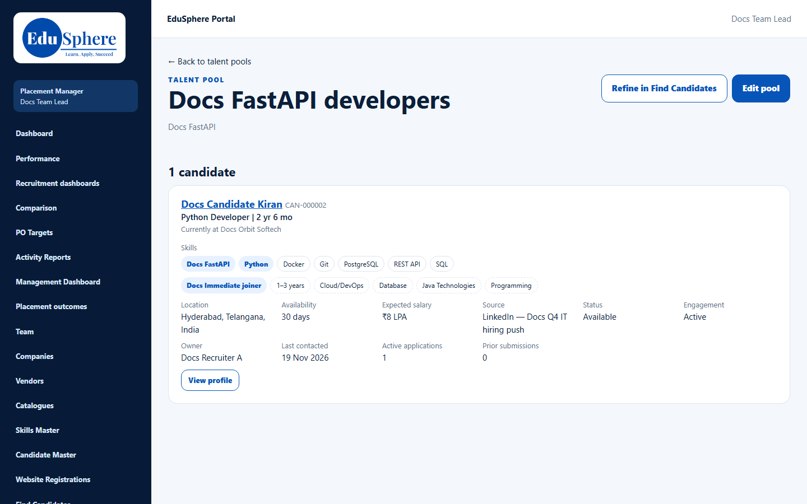

# Talent pools
> Doc ID: DOC-REC-SRCH-005 · Verified on 2026-11-19 against `main` @ `6b61546c` · Roles: Recruiter and HR (read), Team Lead (manage)

## Purpose
Keep ready-made groups of candidates by skill and experience, which fill themselves, so you can open "Python Developers" or "Freshers" in one click.

## Who Can Use This Feature
- **Recruiter** and **HR**: open the pools.
- **Team Lead**: also **+ New pool**, **Edit pool** and **Show inactive pools**.

## Prerequisites
- None. Six pools exist from the start: Cloud Engineers, Experienced Professionals, Freshers, Full Stack Developers, Java Developers, Python Developers.

## How to Access
Sidebar → **Talent Pools** (`/recruiter/pools`).

## Steps
### Step 1 — Browse the pools
"Ready-made groups of candidates by skill and experience. Candidates join a pool automatically as soon as they match its rule." Each pool shows its rule (for example "1+ year of experience" or "AWS, Azure or GCP") and how many candidates it holds.

### Step 2 — Open a pool
Select the pool. **Experienced Professionals** held Ravi, Meena and Kiran, each as a search card with **View profile**. **Refine in Find Candidates** opens the pool's rule as a search to narrow further.

### Step 3 — Add a pool (Team Lead)
Select **+ New pool**: **Pool name**, **Must have all of these skills** (with **+ Add an "at least one of" group**) and **Experience from/to (years)** ("0" means under 1 year, freshers). "Use skills, an experience range, or both." Select **Create pool**.

The pool page opens with the candidates who already match: **Docs FastAPI developers** held Docs Candidate Kiran at once.

## Tips
- Pools are rules, not lists: the pool page has no add or remove button. To change who is in a pool, change the candidate's skills or experience, or the pool's rule.
- A [job requirement's visibility](../requirements/req-008-visibility.md) can be limited to one pool (**Segment (talent pool)**).

## Related Features
- [Find Candidates](srch-001-find-candidates.md)
- [Visibility](../requirements/req-008-visibility.md)
