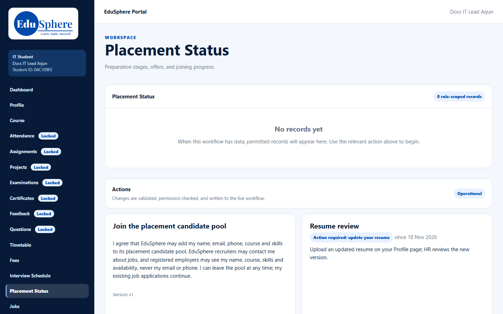
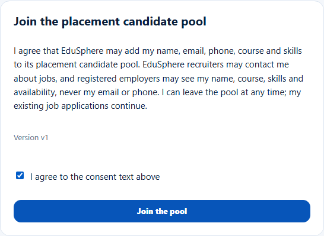
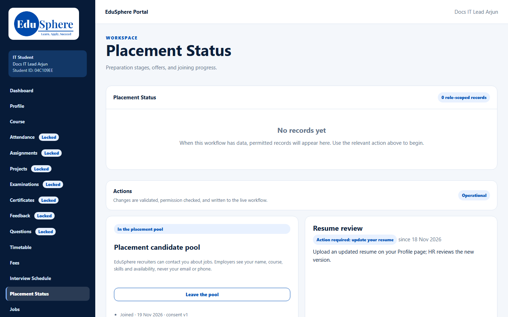

# IT student joins or leaves the placement pool
> Doc ID: DOC-REC-STU-001 · Verified on 2026-11-19 against `main` @ `6b61546c` · Roles: IT student

## Purpose
Let an EduSphere IT student choose to be in the placement candidate pool, so EduSphere recruiters can put them forward for jobs.

## Who Can Use This Feature
- An enrolled **IT student**, in their own IT Training portal. The consent is the student's own.

## Prerequisites
- An IT student account (here Docs IT Lead Arjun, enrolled in Docs Full Stack Python, Docs FSP Batch 1, from the IT Counselor guide).

## How to Access
Sign in at `/it/login` → **Placement Status** (`/it/student/placement-status`).

## Steps
### Step 1 — Read the consent
**Join the placement candidate pool** shows the consent text: "I agree that EduSphere may add my name, email, phone, course and skills to its placement candidate pool. EduSphere recruiters may contact me about jobs, and registered employers may see my name, course, skills and availability, never my email or phone. I can leave the pool at any time; my existing job applications continue." and its **Version** (v1).

### Step 2 — Join
Tick **I agree to the consent text above** and select **Join the pool**: **You have joined the placement candidate pool.**

### Step 3 — In the pool
The card now reads **In the placement pool**, "EduSphere recruiters can contact you about jobs. Employers see your name, course, skills and availability, never your email or phone.", **Joined · {date} · consent v1**, and **Leave the pool**. **Documents for placement** now shows **Requested from you** and lets the student upload documents.

### Step 4 — Leave the pool
Select **Leave the pool** at any time. Existing job applications continue (consent text). Not done in this guide, so Arjun stays in the pool for the hiring sessions.

## Validation Messages
| Message | When |
|---|---|
| You have joined the placement candidate pool. | Joined |

## Tips
- Joining adds the student to the [Candidate Master](../candidates/can-001-candidate-list.md) at once, with source **Edusphere students** and no primary recruiter: the Team Lead assigns one from the [Unassigned queue](../candidates/can-013-unassigned-routing.md).
- The **Resume review** card on the same page belongs to the IT Counselor flow (HR reviews the student's resume).

## Related Features
- [What staff see for IT students](stu-002-staff-view.md)
