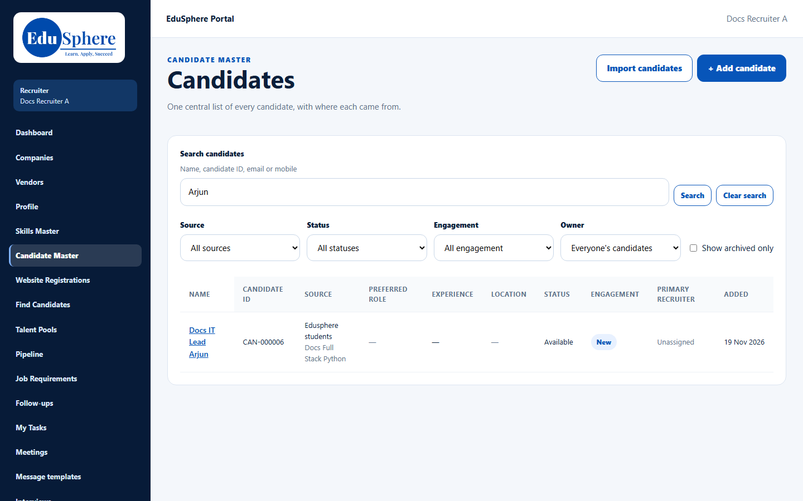
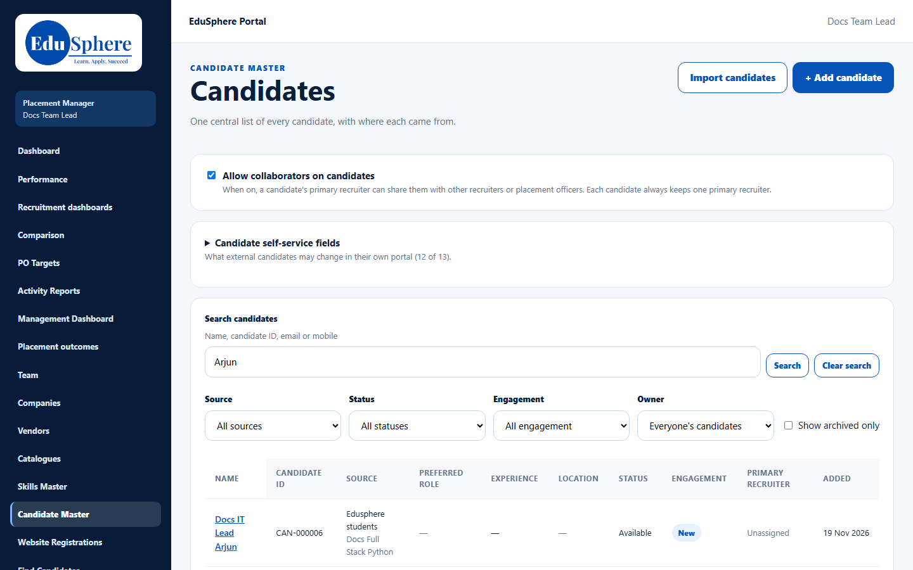
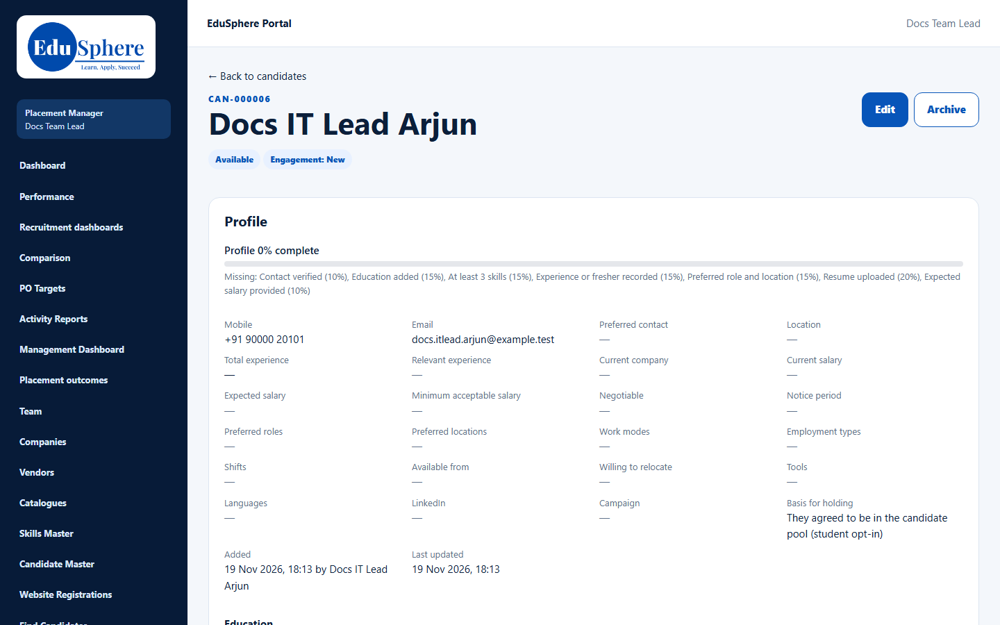
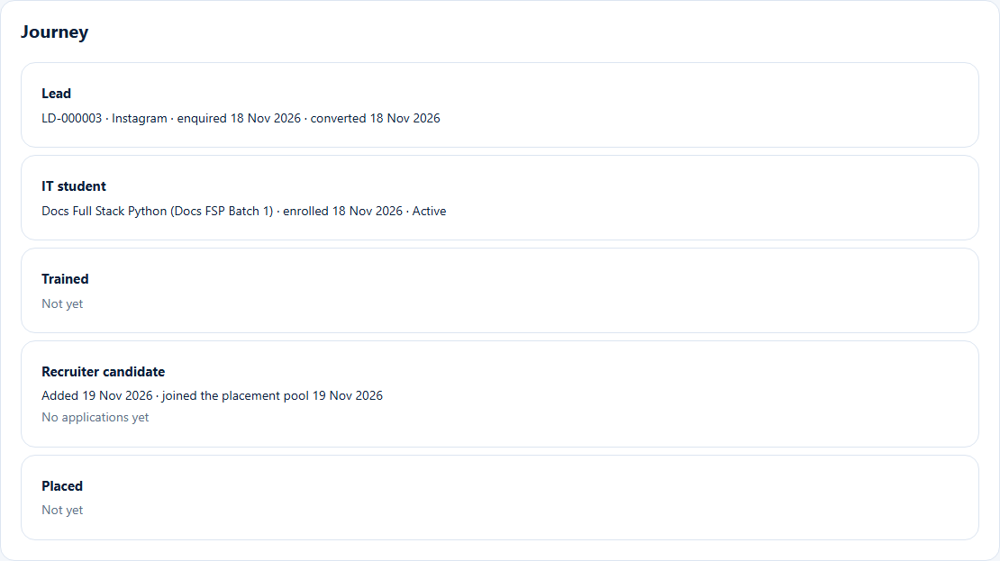
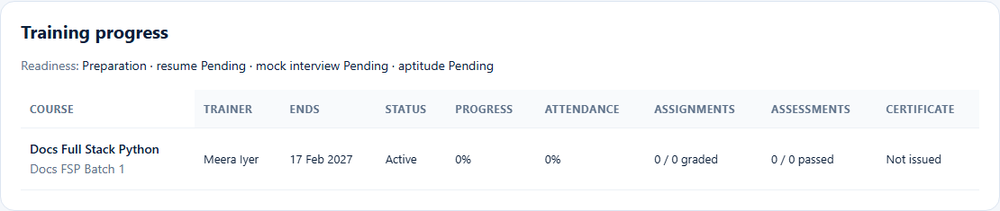

# What staff see for an IT student: Journey and training progress
> Doc ID: DOC-REC-STU-002 · Verified on 2026-11-19 against `main` @ `6b61546c` · Roles: Recruiter, Team Lead

## Purpose
Show recruiters, on the candidate page, where an IT student came from and how their training is going, so they can judge job-readiness.

## Who Can Use This Feature
- **Recruiter** and **Team Lead**, on any candidate. For people who are not IT students the cards say so.

## Prerequisites
- The student [joined the placement pool](stu-001-join-pool.md).

## How to Access
**Candidate Master** → search the name → open the candidate.

## Steps
### Step 1 — Find the student
Search "Arjun": **Docs IT Lead Arjun**, **CAN-000006**, source **Edusphere students** (detail Docs Full Stack Python), engagement **New**, primary recruiter **Unassigned**.

The Team Lead sees the same row.

### Step 2 — Open the candidate page
It is the normal [candidate page](../candidates/can-003-candidate-page.md). **Basis for holding** reads "They agreed to be in the candidate pool (student opt-in)", added by the student. The profile starts at **0% complete**: the student's course details do not fill the recruitment profile.

### Step 3 — Journey
**Journey** shows each stage: **Lead** (LD-000003 · Instagram · enquired and converted 18 Nov 2026), **IT student** (Docs Full Stack Python (Docs FSP Batch 1) · enrolled 18 Nov 2026 · Active), **Trained** (Not yet), **Recruiter candidate** (added and joined the placement pool 19 Nov 2026; No applications yet) and **Placed** (Not yet).

### Step 4 — Training progress
**Training progress** shows **Readiness** (Preparation · resume, mock interview and aptitude Pending) and a row per course: course and batch, trainer, end date, status, progress, attendance, assignments graded, assessments passed and certificate.

## Tips
- For candidates who are not IT students: "Not an EduSphere IT student — no training to show." and **IT student: Not yet** in the Journey.
- Training figures come from the IT Training side and cannot be edited here.

## Related Features
- [IT student joins the pool](stu-001-join-pool.md)
- [Candidate page](../candidates/can-003-candidate-page.md)
